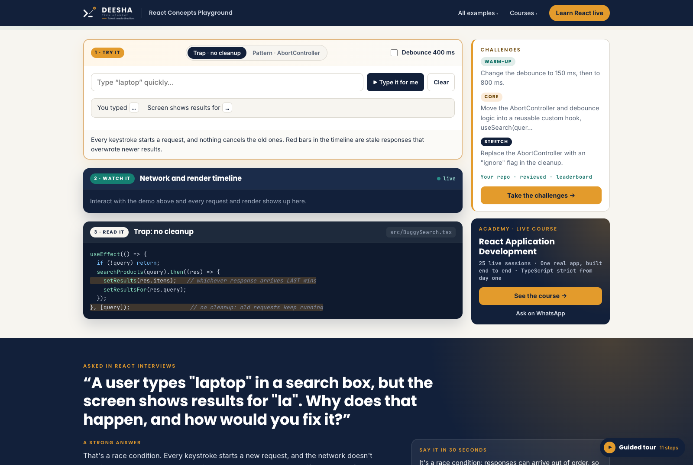
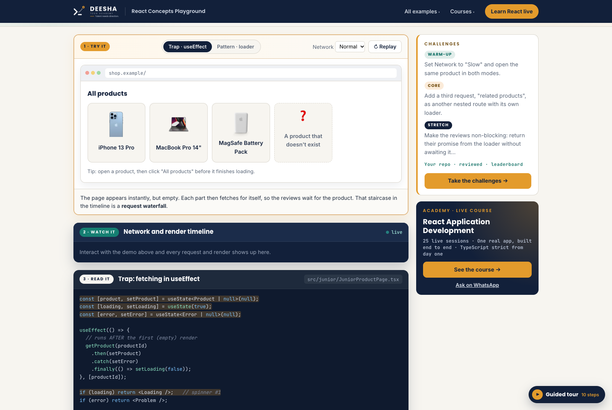
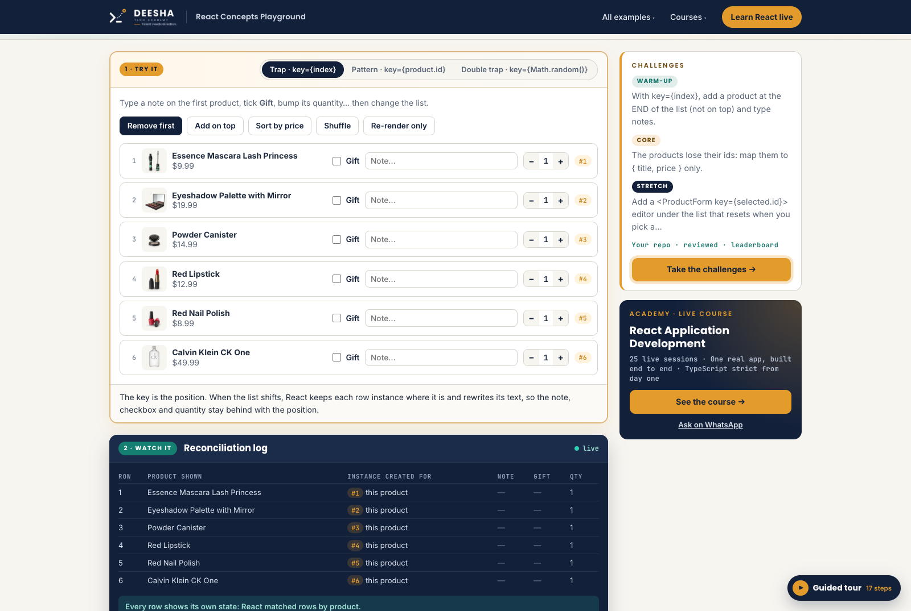
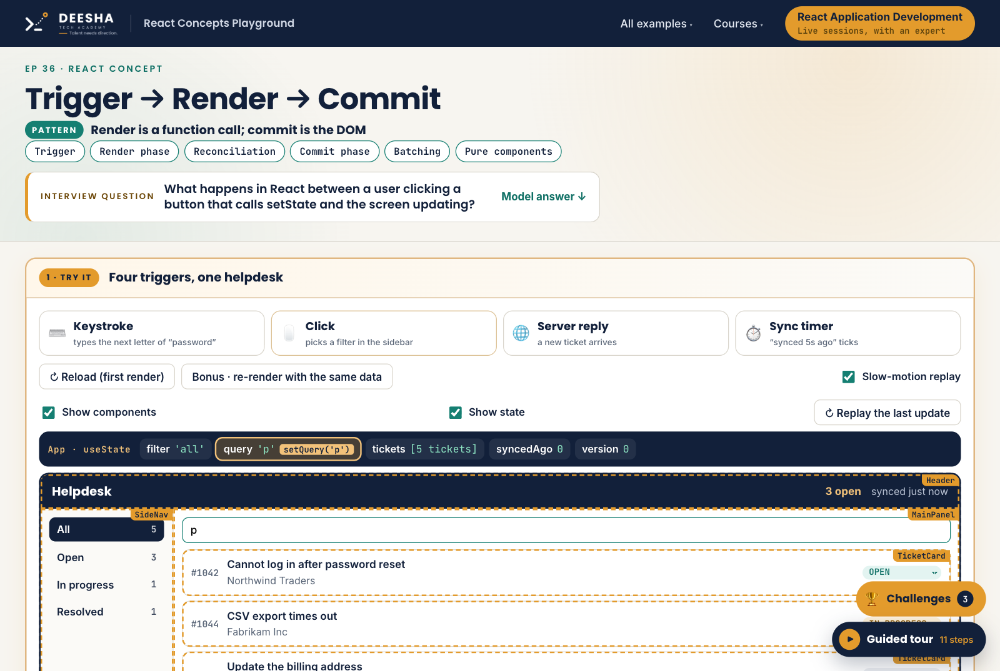
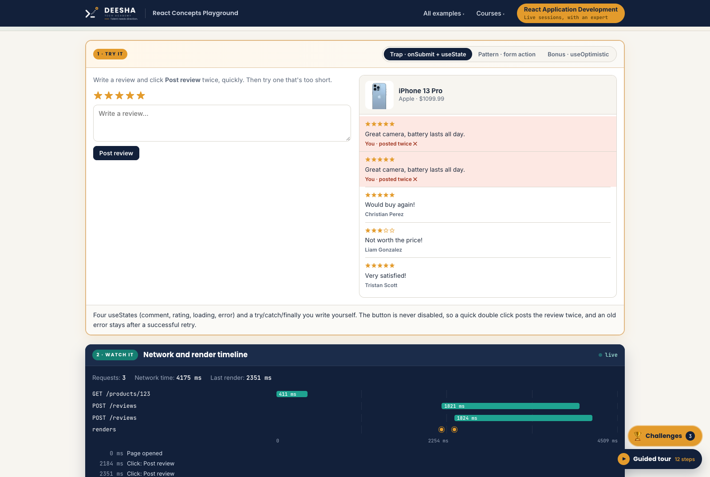
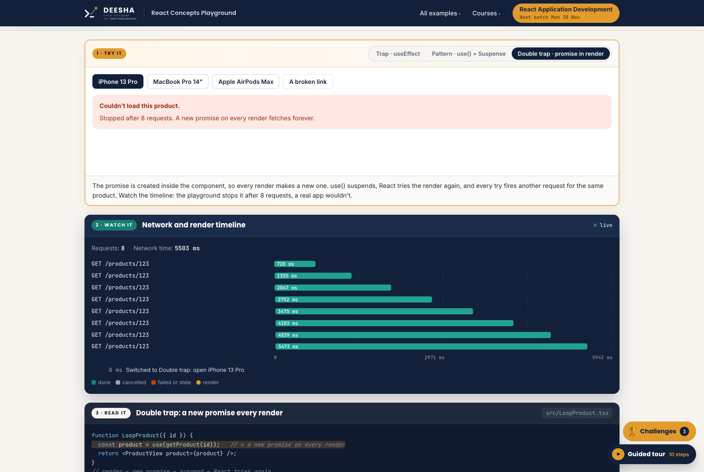

<p align="center">
  <picture>
    <source media="(prefers-color-scheme: dark)" srcset="shell/logo-light.png">
    
  </picture>
</p>

<h1 align="center">React Concepts Playground</h1>

<p align="center">
  <b>Don't just read React. See it happen.</b><br>
  Small, runnable examples from our video series <b>React Important Concepts, Questions &amp; Patterns</b>.<br>
  Watch it · Try it · Explain it.
</p>

<p align="center">
  <a href="https://stackblitz.com/github/deesha-tech/react-concepts-playground/tree/main/examples/19-loaders-vs-useeffect?file=src/senior/routes.tsx"></a>
  &nbsp;
  <a href="https://www.deeshatechacademy.com/academy/courses/react-application-development?utm_source=github&utm_medium=readme&utm_campaign=react-series&utm_content=readme-top"><b>Learn React live with an expert →</b></a>
</p>

---

## ✅ Available now

<table>
  <tr>
    <td width="50%" valign="top">
      <a href="examples/01-race-conditions"></a>
      <h3>Ep 01 · Race Conditions</h3>
      <p>Search "laptop", get lipstick. Watch the slow "la" response overwrite the right results on the timeline, then fix it with AbortController and debounce.</p>
      <p><a href="https://stackblitz.com/github/deesha-tech/react-concepts-playground/tree/main/examples/01-race-conditions?file=src/FixedSearch.tsx"></a></p>
    </td>
    <td width="50%" valign="top">
      <a href="examples/19-loaders-vs-useeffect"></a>
      <h3>Ep 19 · Loaders vs useEffect</h3>
      <p>See the request waterfall that useEffect fetching causes, then switch to React Router loaders: parallel requests, error boundaries and cancellation.</p>
      <p><a href="https://stackblitz.com/github/deesha-tech/react-concepts-playground/tree/main/examples/19-loaders-vs-useeffect?file=src/senior/routes.tsx"></a></p>
    </td>
  </tr>
  <tr>
    <td width="50%" valign="top">
      <a href="examples/08-keys-in-lists"></a>
      <h3>Ep 08 · Index as Key Bug</h3>
      <p>Type a note on a product, delete the row above it, and the note jumps to the wrong product. Watch what React really does to the DOM with key={index}, key={product.id} and key={Math.random()}.</p>
      <p><a href="https://stackblitz.com/github/deesha-tech/react-concepts-playground/tree/main/examples/08-keys-in-lists?file=src/KeyedList.tsx"></a></p>
    </td>
    <td width="50%" valign="top">
      <a href="examples/36-trigger-render-commit"></a>
      <h3>Ep 36 · Trigger → Render → Commit</h3>
      <p>Type one letter: React calls 7 components, and the page changes in just 1 place. Fire a keystroke, a click, a server reply or a timer and watch the trigger, the render and the commit, live.</p>
      <p><a href="https://stackblitz.com/github/deesha-tech/react-concepts-playground/tree/main/examples/36-trigger-render-commit?file=src/Helpdesk.tsx"></a></p>
    </td>
  </tr>
  <tr>
    <td width="50%" valign="top">
      <a href="examples/29-react19-actions"></a>
      <h3>Ep 29 · React 19 Actions</h3>
      <p>Double click "Post review" and it posts twice, and an old error never clears. Then let React 19 run the submit as an Action: pending, errors and the form reset handled for you, and useOptimistic shows the review before the server answers.</p>
      <p><a href="https://stackblitz.com/github/deesha-tech/react-concepts-playground/tree/main/examples/29-react19-actions?file=src/ActionForm.tsx"></a></p>
    </td>
    <td width="50%" valign="top">
      <a href="examples/38-use-hook-suspense"></a>
      <h3>Ep 38 · Goodbye useEffect Fetching</h3>
      <p>Load a product with useEffect and the page renders empty before the request even starts. Read it with React 19 use() and Suspense instead: no loading or error state. Then watch the one mistake that makes use() fetch forever.</p>
      <p><a href="https://stackblitz.com/github/deesha-tech/react-concepts-playground/tree/main/examples/38-use-hook-suspense?file=src/UseProduct.tsx"></a></p>
    </td>
  </tr>
</table>

## 🧩 Patterns we demo

Every example shows a **Trap** (the code that looks fine but breaks) and a **Pattern** (the fix you can reuse). The list grows with the series, and the **All examples** menu in every example shows the whole series, with upcoming episodes muted.

| Pattern | The trap | The pattern | Example |
|---|---|---|---|
| Abort stale requests | A fetch per keystroke with no cleanup: a slow, old response overwrites the latest results | `AbortController` in the effect cleanup, plus an optional debounce | [Ep 01](examples/01-race-conditions) |
| Stable identity keys | `key={index}`: state stays with the position, not the item | `key={item.id}`, an id created with the item, never during render | [Ep 08](examples/08-keys-in-lists) |
| Route loaders for page data | Fetching in `useEffect`: render first, then a request waterfall | A route `loader` + `useLoaderData`: parallel, cancellable, with an error boundary | [Ep 19](examples/19-loaders-vs-useeffect) |
| Read promises with use() | Fetching in `useEffect`: render empty first, then hand-written data, loading and error state | Create the promise outside render, read it with `use()`, wait with `<Suspense>`, catch with an error boundary; never create it inside the component | [Ep 38](examples/38-use-hook-suspense) |
| Form actions | `onSubmit` + useState for loading and error: the button posts twice, an old error never clears | `<form action>` with `useActionState`, `useFormStatus` on the button, `useOptimistic` for instant feedback | [Ep 29](examples/29-react19-actions) |
| Render is a function call; commit is the DOM | "It re-rendered, so it repainted": treating every render as expensive | A setter triggers a render; React compares and commits only the differences, so measure the commit, not the render count | [Ep 36](examples/36-trigger-render-commit) |

## ▶️ How to play with an example in StackBlitz

No installs and no setup. Everything runs in your browser.

1. **Click "Open in StackBlitz"** next to an example. StackBlitz loads the project and runs `npm install` for you. The first load takes a minute.
2. **The app opens on the right, the code on the left.** The file that matters most for the concept opens automatically.
3. **Follow the guided tour.** It starts on your first visit and walks you through the demo step by step: click here, type this, watch that. Restart it any time with the **Guided tour** button at the bottom right.
4. **Play with the demo yourself.** Use the toggle to switch between the **Trap** and the **Pattern**, and watch the **network and render timeline** show every request and render as it happens.
5. **Read the highlighted code** under the demo: these are the lines that make the difference.
6. **Take the challenges.** The **Challenges** button (bottom right) opens three of them: Warm-up, Core and Stretch. Sign in to the learning portal, commit your solution to your own repository, and get it reviewed.
7. **Read the interview question** at the bottom: a model answer, a 30-second version and the follow-ups interviewers ask.
8. **Keep your version.** Click **Fork** in StackBlitz (sign in with GitHub) to save your changes to your own account.

## 📚 The full series

New examples arrive with each episode. Follow along on Instagram and YouTube so you don't miss one.

| Ep | Concept | What you'll learn | Playground |
|---|---|---|---|
| **01** | **[Race Conditions](examples/01-race-conditions)** | **The React interview question most candidates miss** | ✅ **[Open in StackBlitz](https://stackblitz.com/github/deesha-tech/react-concepts-playground/tree/main/examples/01-race-conditions?file=src/FixedSearch.tsx)** |
| 02 | Cart Empty After Refresh | Persist state the right way, and survive the next release | 🔜 Coming soon |
| 03 | One Crash, Blank App | Error Boundaries, and what they can't catch | 🔜 Coming soon |
| 04 | A Hook Inside an If | Why hooks must be called at the top level | 🔜 Coming soon |
| 05 | Counter Stuck at 1 | Stale closures, explained in 90 seconds | 🔜 Coming soon |
| 06 | The Dependency Array | No array vs [] vs [a, b], once and for all | 🔜 Coming soon |
| 07 | Why useEffect Runs Twice | StrictMode, and why it's actually helping you | 🔜 Coming soon |
| **08** | **[Index as Key Bug](examples/08-keys-in-lists)** | **Why key={index} breaks lists, and what React really does to the DOM** | ✅ **[Open in StackBlitz](https://stackblitz.com/github/deesha-tech/react-concepts-playground/tree/main/examples/08-keys-in-lists?file=src/KeyedList.tsx)** |
| 09 | You Might Not Need an Effect | Derived state and event handlers over effects | 🔜 Coming soon |
| 10 | Controlled vs Uncontrolled | When to use each, with real form examples | 🔜 Coming soon |
| 11 | The Context Re-render Trap | Why one big Context hurts, and three fixes | 🔜 Coming soon |
| 12 | useMemo & useCallback Myths | When memoisation helps, and when it's useless | 🔜 Coming soon |
| 13 | Build a Custom Hook | The custom hook pattern every interviewer asks about | 🔜 Coming soon |
| 14 | Props, Context or Store? | A simple decision guide for state in React | 🔜 Coming soon |
| 15 | Filters in the URL | Shareable, refresh-proof, back-button friendly | 🔜 Coming soon |
| 16 | Token Expires Mid-Request | The axios refresh queue senior devs use | 🔜 Coming soon |
| 17 | Axios Interceptors | One API layer: interceptors and a single ApiError | 🔜 Coming soon |
| 18 | Protected Routes & Roles | Route guards, and why the server must check too | 🔜 Coming soon |
| **19** | **[Loaders vs useEffect](examples/19-loaders-vs-useeffect)** | **Data before render with React Router loaders** | ✅ **[Open in StackBlitz](https://stackblitz.com/github/deesha-tech/react-concepts-playground/tree/main/examples/19-loaders-vs-useeffect?file=src/senior/routes.tsx)** |
| 20 | Slow Loader Blocks Navigation | Await only what's critical, stream the rest | 🔜 Coming soon |
| 21 | Optimistic UI | Optimistic updates, with rollback when things fail | 🔜 Coming soon |
| 22 | Forms with RHF + Zod | react-hook-form + Zod, the production setup | 🔜 Coming soon |
| 23 | 10,000 Rows Are Janky | Measure first, then virtualise | 🔜 Coming soon |
| 24 | 50 Updates a Second | Batch the stream, select only what changed | 🔜 Coming soon |
| 25 | Server State vs Client State | TanStack Query / RTK Query for server state | 🔜 Coming soon |
| 26 | Zustand vs Redux Toolkit | Same feature, two stores, when to pick which | 🔜 Coming soon |
| 27 | Compound Components | The compound component pattern | 🔜 Coming soon |
| 28 | Modals with Portals | Portals, z-index and overflow, explained | 🔜 Coming soon |
| **29** | **[React 19 Actions](examples/29-react19-actions)** | **Actions, useActionState and pending states** | ✅ **[Open in StackBlitz](https://stackblitz.com/github/deesha-tech/react-concepts-playground/tree/main/examples/29-react19-actions?file=src/ActionForm.tsx)** |
| 30 | What to Test in React | Test what users see, with React Testing Library | 🔜 Coming soon |
| 31 | Why Did It Re-render? | What actually triggers a re-render | 🔜 Coming soon |
| 32 | Copying Props into State | Why useState(props.x) goes stale | 🔜 Coming soon |
| 33 | useRef vs useState | When a value should not re-render | 🔜 Coming soon |
| 34 | A 2 MB Bundle on Mobile | Lazy routes and code splitting | 🔜 Coming soon |
| 35 | Where Does This State Live? | 3 features, 3 state decisions, 1 trap | 🔜 Coming soon |
| **36** | **[Trigger → Render → Commit](examples/36-trigger-render-commit)** | **React's 3 phases, in one keystroke** | ✅ **[Open in StackBlitz](https://stackblitz.com/github/deesha-tech/react-concepts-playground/tree/main/examples/36-trigger-render-commit?file=src/Helpdesk.tsx)** |
| 37 | Rendered, But Nothing Changed | State is a snapshot: what really happens when you call set | 🔜 Coming soon |
| **38** | **[Goodbye useEffect Fetching](examples/38-use-hook-suspense)** | **React 19 use() + Suspense, and the bug that loops forever** | ✅ **[Open in StackBlitz](https://stackblitz.com/github/deesha-tech/react-concepts-playground/tree/main/examples/38-use-hook-suspense?file=src/UseProduct.tsx)** |

## What every example includes

- a **guided tour** that walks you through the demo, step by step
- a **live demo** with real data from [DummyJSON](https://dummyjson.com) and a toggle between the problem and the fix
- a **network and render timeline**, so you see what the code does, not just read about it
- the **key lines of code**, highlighted
- the **interview question** with a model answer, a 30-second version and follow-ups
- graded **challenges** (Warm-up, Core, Stretch) to try on your own

## Run an example locally

```bash
git clone https://github.com/deesha-tech/react-concepts-playground.git
cd react-concepts-playground/examples/19-loaders-vs-useeffect
npm install
npm run dev
```

Each example is a self-contained Vite + React + TypeScript project. Data comes live from [DummyJSON](https://dummyjson.com), the same API the course app uses, with deliberate delays so the timing is easy to see.

## Built from the same stack as the course

React 19 · React Router 8 · TypeScript strict · Vite. These examples teach one concept each. In our **React Application Development** course you build a complete production-ready app around all of them, live: routing, data loading, auth, state management, testing, CI and deployment.

- 🚀 **React Application Development**: [deeshatechacademy.com/academy/courses/react-application-development](https://www.deeshatechacademy.com/academy/courses/react-application-development?utm_source=github&utm_medium=readme&utm_campaign=react-series&utm_content=readme)
- 🌐 **Everything else we teach**: [deeshatechacademy.com](https://www.deeshatechacademy.com/?utm_source=github&utm_medium=readme&utm_campaign=react-series)

## For contributors

The Deesha header, menu, course cards and timeline live in [`shell/`](shell). Every example has its own copy so StackBlitz can open each folder on its own. After editing `shell/`, run:

```bash
npm run sync
```

To add an example, copy an existing folder in `examples/`, change `src/episode.ts`, `package.json` and `index.html`, and replace the demo.

## Licence

These examples are for **learning and teaching**. You can read, run, change and share them for personal study, in classrooms and for any other non-commercial purpose. Using them in a paid course, product or service needs our written permission: contact@deeshatechacademy.com.

Licensed under the [PolyForm Noncommercial License 1.0.0](LICENSE).

---

<p align="center">© 2026 <a href="https://www.deeshatechacademy.com/?utm_source=github&utm_medium=readme&utm_campaign=react-series">Deesha Tech Academy</a> · Talent needs direction.</p>
